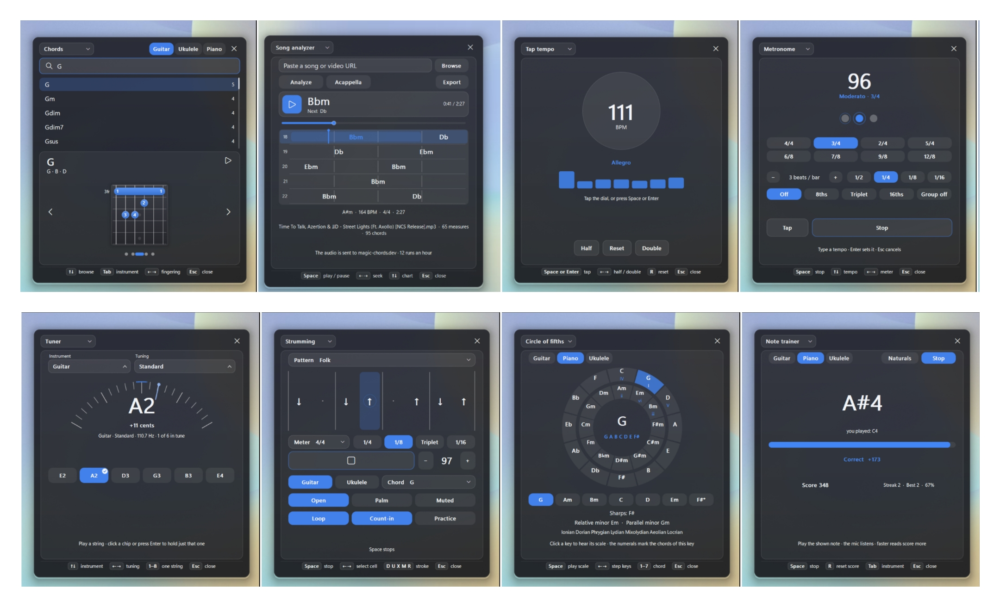

# Musician's Toolkit

A [Windhawk](https://windhawk.net/) mod that puts the things you reach for
while you practise into one small panel on top of Windows: a chord library, a
song analyzer that plays the chart, a chromatic tuner, a metronome, a strumming
pattern builder, an interactive circle of fifths, a tap tempo and a timed note
trainer.

Press **Win+Y** to open it, or click the icon it leaves in the notification
area. The panel floats above your other windows, so a click or a chord chart can
sit beside your DAW, tab app or video lesson, and it keeps running when you
click away from it. Everything except the analyzer is drawn and synthesised by
the mod itself - no images, no audio files - so it behaves the same on any
machine.



## What's in it

| Tool | What it does |
| --- | --- |
| Chords | Search a chord, then read it off a fretboard or a keyboard; every fingering the library knows is a click or an arrow away, and **Tab** plays the one on screen. |
| Song analyzer | Paste a link or pick a file, and the chords come back as a chart you can play: a playhead over time-scaled measures, a scrubber, and the chord you are on in large type. |
| Tuner | Twelve instruments and their common tunings, with a chromatic fallback for anything else. |
| Metronome | Eight meters, subdivisions, a tempo you can type, and it keeps playing after the panel closes. |
| Strumming | A one-measure grid, 38 patterns in eight meters, three strum sounds, and a practice ramp. |
| Circle of fifths | Both rings at once, so the majors and their relative minors sit on the same spoke. |
| Tap tempo | Tap out a tempo, see how steady you were, then halve, double or reset it. |
| Note trainer | A note name, a countdown and a microphone, scored for speed and streak. |

## Requirements

- Windows 10 or 11.
- Windhawk, set up and running.
- A microphone for the tuner and the note trainer.

## Installing

1. Install [Windhawk](https://windhawk.net/) and let it finish its first
   setup.
2. Open Windhawk, go to the **Mods** tab and click **Create new mod**.
3. Set the id to `musicians-toolkit`, replace the template code with the whole
   of `musicians-toolkit.wh.cpp`, and click **Compile mod**.
4. Turn the mod on and press **Win+Y**, or click the icon it puts in the
   notification area.

The mod is a single file and needs nothing beside it: the chord shapes are
packed into the source. It loads into `windhawk.exe` only, so it does not
inject anything into the programs you have running.

## Keyboard shortcuts

| Keys | Does |
| --- | --- |
| `Win+Y` | Open or close the panel. The key and the modifiers are configurable. |
| `Ctrl+Tab` | Switch tools. |
| Tray icon | A click opens or closes the panel; a right-click names every tool so one can be opened in a step. |
| `Tab` | Play the chord on the card, and step through the pattern list without opening it. |
| `Shift+Tab` | Switch instrument. |
| `Up` / `Down` | Move through search results, step the metronome, walk the analyzer's chart, hop between the two rings of the circle. |
| `Left` / `Right` | Step through fingerings, halve or double a tap tempo, change the metronome's meter, skip five seconds in the analyzer. |
| `D` `U` `X` `M` `R` | Lay a downstroke, upstroke, muted downstroke, muted upstroke or a rest on the strumming grid. |
| `A` `G` `T` `C` | Accent, ghost note, tie and clear the strumming bar. |
| `Space` | Play the chord on the card, tap tempo, start or stop a note training round, play or pause the analyzed song. |
| `Enter` | Play the chord on the card as well: the key sits by the right hand, beside the arrows. |
| `0` - `9` | Type a tempo in the metronome or the strumming tool; `Enter` sets it, `Esc` cancels. |
| `1` - `7` | Play a diatonic chord of the selected key. |
| `R` | Reset the note trainer's score. |
| `N` | Keep the note trainer to the naturals. |
| `Esc` | Clear the search, cancel a typed tempo, or close the panel. |

## Strumming patterns

The list is grouped by the grid the pattern is written in - quarters, eighths,
triplets, sixteenths - and picking one moves the grid chips to match, so a
pattern always arrives with the cells it was notated for.

| Meter | Patterns |
| --- | --- |
| 4/4 | Downstrokes, Eighths, Down-up, Folk, Pop, Backbeat, Skank, Chug, Shuffle, Sixteenths |
| 3/4 | Downstrokes, Waltz, Eighths, Shuffle, Sixteenths |
| 2/4 | Downstrokes, Eighths, Off-beats, Shuffle, Sixteenths |
| 5/4 | Three-two, Two-three, Eighths, Shuffle, Sixteenths |
| 6/8 | Downstrokes, Ballad, Eighths, Sixteenths |
| 7/8 | Two-two-three, Three-two-two, Sixteenths |
| 9/8 | Downstrokes, Ballad, Sixteenths |
| 12/8 | Downstrokes, Shuffle, Sixteenths |

## Song analyzer

Paste a link to a song or a video, or pick a file with **Ctrl+O**, and the panel
has it transcribed by [magic-chords.dev](https://magic-chords.dev): the chords
measure by measure, the key, the tempo and the meter. What comes back is a
player rather than a printout.

- **Chart** - one row per measure, the beats ticked off behind it and each chord
  placed at the moment it is played. The measure the song is in is lit and the
  playhead sweeps across it, so the chart reads the way the song goes.
- **Now playing** - the strip above the chart names the chord sounding, the one
  coming next and the time, and the row follows the playhead as it walks a long
  song. Scrolling by hand holds the follow off for a moment, so you can look
  ahead without being pulled back.
- **Transport** - **Space** plays and pauses, **Left** and **Right** skip five
  seconds, **Ctrl** with an arrow steps a whole measure, and **Home** and **End**
  go to the two ends. The scrubber, the circular button and any point on the
  chart seek straight to that moment.
- **Audio** - a file picked from disk plays as the chart moves, and the chart is
  driven by the media clock so the chord on screen is the chord you hear. A link
  gets its audio the same way: a link that points straight at an audio file is
  downloaded by the mod, and YouTube, SoundCloud and the rest are fetched with
  [yt-dlp](https://github.com/yt-dlp/yt-dlp) when it is installed (`winget
  install yt-dlp` puts it where the mod looks). Point Settings > Analyzer at
  `yt-dlp.exe`, or leave it empty and the usual install folders and PATH are
  searched. With no extractor the chart still walks the song's own timing,
  silently. While a chart has nothing the player can take - a link with no
  audio, or a video file - the chip beside the URL field turns into **Audio**:
  pick the song by hand and it plays under that same chart without being
  analyzed again.
- **Export** - every run can be saved as PDF, MIDI, MusicXML, text, CSV or JSON
  from the Export chip.

A run takes about a minute and the free service allows twelve an hour. Closing
the panel does not stop a run: it is there when you come back.

## Settings

| Group | Holds |
| --- | --- |
| Startup | The tool and instrument the panel opens with. |
| Appearance | Theme, accent colour, panel opacity. |
| Placement | Corner, monitor, offsets, whether the panel closes when it loses focus, and whether it keeps a tray icon. |
| Shortcut | The key and modifiers that open the panel. |
| Metronome | Volume, background playback, default meter and subdivision. |
| Chords | Whether to hide the finger numbers. |
| Tap tempo | How long a pause resets the taps, and whether Space or Enter tap. |
| Tuner | Reference pitch, from 415 to 466 Hz. |
| Strumming | Default grid, count-in, loop, and the practice ramp and target. |
| Circle of fifths | Which ring opens, and whether selecting a key plays its scale. |
| Note trainer | Seconds per note, and chromatic or naturals only. |
| Song analyzer | The service the analyzer talks to, the folder its exports are saved in, and the yt-dlp path used to fetch a link's audio. |

## Notes on how it works

- The panel is painted by a small software renderer that ships in the file
  itself: no browser, no UI framework, no resource files.
- The plucked voices are Karplus-Strong strings, and the piano is a struck
  model of the same shape, all rendered at the device's own sample rate.
- The metronome renders in blocks on its own thread and publishes the cue a
  block late, so the playhead on the strumming grid lands where the sound does
  rather than where the clock does.
- Chord shapes come from chords-db, packed into the mod at build time.

## Working on it

The mod is compiled by Windhawk, not by a local toolchain, so the source has to
stay well formed for the editor's compiler. These scripts keep an eye on the
parts that are easy to break by hand:

| Command | Checks |
| --- | --- |
| `node tools/check-balance.js` | Braces, parens and brackets balance across the file, and prints the line count. |
| `node tools/check-settings.js` | Every setting in the YAML is one `LoadSettings` actually asks for, so a typo cannot fall back to a default unnoticed. |
| `node tools/check-presets.js` | Every strumming pattern is `beats * subdivision` cells long, the rows of a meter run from the thinnest grid up, and the busiest list still fits the card. |
| `node tools/build-chord-data.js` | Rebuilds the packed chord data from `data/*.json` and writes it into the mod. |
| `node tools/inspect-data.js` | A structural report of the chords-db files, for when the decoder looks wrong. |

Run the three checks before compiling - one per line, since Windows PowerShell
does not accept `&&`:

```
node tools/check-balance.js
node tools/check-presets.js
node tools/check-settings.js
```

## Credits

Chord data by David Rubert from
[chords-db](https://github.com/tombatossals/chords-db), MIT licensed and
packed into the mod.

Released under the MIT license.
